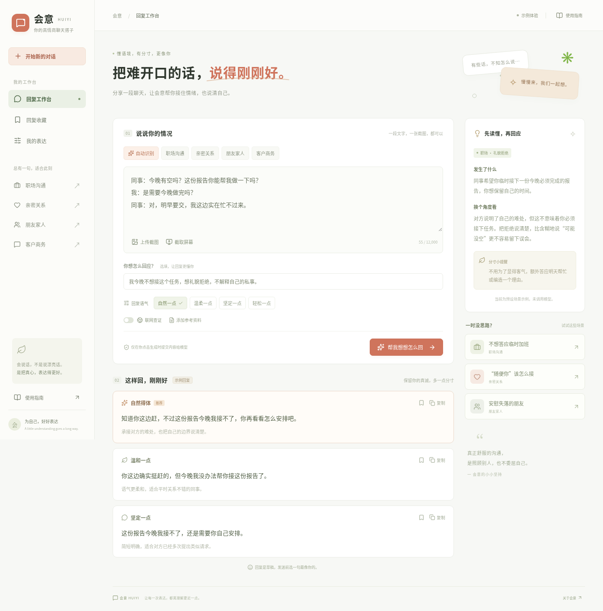

# 会意 HUIYI · 高情商聊天助手

把难开口的话，说得刚刚好。

独立运行的中文 AI 聊天辅助网站：粘贴文字、上传聊天截图或授权截取屏幕，结合场景、语气和沟通目标生成三种可直接复制的回复。使用 **Next.js + React + TypeScript**，可从 GitHub 导入 Vercel，也支持 Docker 部署，不依赖自定义 GPT 或 GPT 插件。



## 已实现

- **多模态输入**：文字、截图上传、粘贴图片、拖放图片；最多 3 张，浏览器本地压缩后发送。
- **桌面截图**：用户点击后调用浏览器屏幕共享授权，仅截取一帧，随后立即停止共享。需要 HTTPS 或 localhost，以及浏览器支持。
- **场景与语气**：自动识别 / 职场 / 亲密关系 / 朋友家人 / 客户商务；自然 / 温柔 / 坚定 / 轻松。
- **自然回复**：推荐与两种备选表达，附场景理解、可能解释和边界提醒；支持复制、当前设备收藏和表达偏好。
- **公开资料查证**：可选 Responses API 内置网页搜索，显示实际检索引用。搜索使用单独请求，只包含用户明确填写的公开主题，不包含私聊正文、图片、偏好或本地资料。
- **本次参考资料**：支持 TXT / Markdown，最多 16,000 字符；随本次分析提交，未接入私人云知识库或向量数据库。
- **服务端调用**：API Key 不进入浏览器，支持访问口令、请求大小限制、输入校验、超时、取消及单实例限流。
- **真实区分示例和 AI**：无需密钥即可查看 3 个标注的预设场景。未配置模型时，自定义输入不会被伪装成已经分析。

## 本地运行

需要 Node.js 22 或更高版本。

```bash
npm ci
cp .env.example .env.local
npm run dev
```

在浏览器打开开发服务器。无 API Key 时可体验示例、上传、偏好和收藏。要分析自己的内容，在 `.env.local` 设置：

```dotenv
AILIAO_API_KEY=你的模型密钥
AI_MODEL=gpt-4.1-mini
APP_ACCESS_TOKEN=你自己设置的站点访问口令
```

真实值只放本地环境文件或部署平台的环境变量中，不要提交到 GitHub。设置后重启开发服务器，在网站「我的表达」中输入站点访问口令。

默认使用 OpenAI Responses API。可通过 `OPENAI_BASE_URL` 修改服务端地址，但对应服务必须实际支持 **`/responses`、图片输入和 JSON Schema 结构化输出**；开启联网还需要支持 `web_search`。仅兼容 Chat Completions 的服务不能直接使用本实现。

## 部署

推荐从 GitHub 导入 **Vercel**：选择本仓库 → 使用自动识别的 Next.js 配置 → 设置 `AILIAO_API_KEY` 和 `APP_ACCESS_TOKEN` → 部署。

GitHub 保存代码；Vercel 或其他 Node.js 平台运行网站和服务端 API。**GitHub Pages 无法独立运行本项目的模型接口**。

生产环境默认要求访问口令。若你明确希望任何访客都可以使用付费模型接口，可设置 `ALLOW_PUBLIC_ACCESS=true`，同时自行配置额度和更完善的限流。访问口令只在网页当前内存中保存，刷新后需重新输入。

[完整部署与故障排查说明](docs/部署指南.md)

## 验证

```bash
npm run typecheck
npm test
npm run build

# 首次运行浏览器测试时安装 Chromium：
npx playwright install chromium
npm run test:e2e
```

接口测试使用本地模拟模型服务，检查真实 HTTP 调用、鉴权、错误处理、结构化返回和检索内容隔离。浏览器测试覆盖示例切换、收藏、偏好、图片和资料上传、生成请求及手机布局，生成结果通过模拟接口返回。

这些测试**不等于真实模型的语义质量、OCR 准确度或搜索覆盖率验证**。首次部署后仍需用实际 Key 进行文字、清晰截图、模糊截图和联网查证的人工验收。当前开发环境没有模型 Key，尚未进行真实模型调用。

## 数据与使用边界

- 点击生成时，聊天正文、压缩截图、目标、偏好和本次参考资料发送给配置的模型服务。启用联网时，单独的检索主题会用于网页搜索，请不要在主题中填写隐私。
- 应用没有数据库，不主动持久化输入的聊天和截图，也不记录请求正文。部署平台和模型供应商仍有各自的数据处理规则；`store: false` 不代表所有服务都绝对不保存数据。
- 收藏与偏好保存在当前浏览器的 localStorage；收藏是用户主动选择的回复，最多 50 条。清除浏览器数据会清除它们。
- 不会后台读屏、不连接微信、不自动发送消息。浏览器截图可能包含你选择区域内的其他信息，发送前请检查或打码。
- 输出是待确认的草稿，不提供人格诊断、情感定论或操控套路，也不替用户做实际承诺。
- 内置限流是每实例、每 IP、每分钟 8 次；多实例或公网商用部署应使用共享配额系统，并在供应商侧设置支出限制。首版没有账户系统和多用户权限管理。

## 目录

```text
app/                 页面、样式和服务端 API
lib/                 数据校验、模型调用、提示词、示例与图片处理
tests/               接口与浏览器测试
docs/                部署文档与预览图
custom-gpt/          前期沟通原则与知识资料，网站无需创建自定义 GPT
templates/           可选表达偏好模板
tools/               standalone 资源准备和前期配置包工具
```

License: [Unlicense](LICENSE)。
